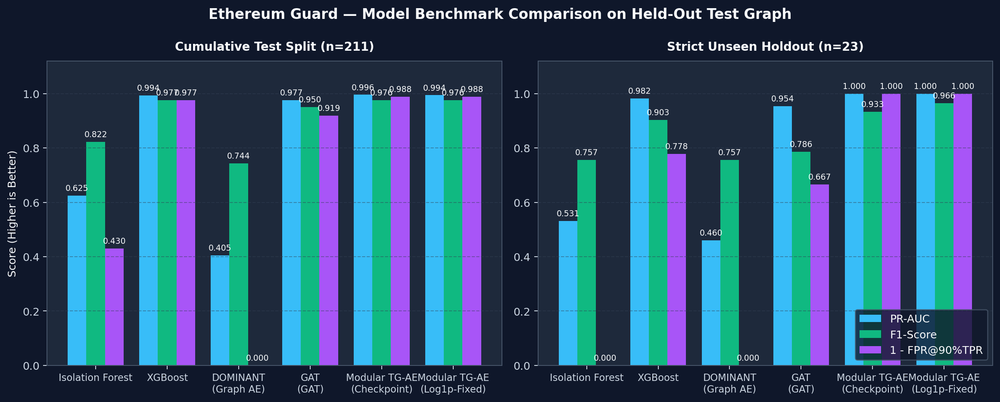

# ETHEREUM_GUARD_Project

**Mô hình phát hiện bất thường trong giao dịch Ethereum bằng học sâu (*Deep Learning Transaction & Account Anomaly Detection over Ethereum Graphs*)**

Hệ thống học sâu hai cấp độ (**Dual-Granularity Deep Learning**) phát hiện bất thường trên mạng lưới giao dịch Ethereum ở cả **cấp độ từng giao dịch (`tx_hash` — 66 ký tự)** lẫn **cấp độ tài khoản (`address` — 42 ký tự)**, đi kèm giải thích **XAI**, trực quan hóa đồ thị **1-Hop Ego-Network**, **FastAPI REST Service**, **Streamlit Dashboard**, và tích hợp quét trực tiếp **Etherscan API V2**.

---

## Kiến trúc Học sâu Cốt lõi

1. **Cấp độ Giao dịch (`DeepTransactionScorer` — `src/models/tx_scorer.py`):**
   - Hợp nhất biểu diễn sâu $z_u, z_v \in \mathbb{R}^{64}$ của ví gửi và ví nhận từ **Modular TG-AE** cùng tương tác cạnh ($|z_u - z_v|$, $z_u \odot z_v$), 5 thuộc tính cạnh (`edge_attr`) và 6 tín hiệu **Behavioral Shock** (độ đột biến giá trị giao dịch so với trung bình lịch sử ví gửi, giao dịch gọi hợp đồng `0 ETH`, chữ ký hàm EVM 4-byte `approve`/`transferFrom`/`permit`).
2. **Cấp độ Tài khoản (`Modular TG-AE` — `src/models/encoders.py`, `src/models/tgae.py`):**
   - **TabularMLP:** Mã hóa 12 đặc trưng dòng tiền tĩnh.
   - **EdgeTransformerEncoder (`TransformerConv`):** Graph Transformer 2 lớp đa đầu chú ý tích hợp trọng số cạnh 5 chiều trên đồ thị con lân cận.
   - **TemporalAttentionGRU:** Mạng GRU 2 lớp kèm cơ chế chú ý thời gian Bahdanau trên chuỗi `10 × 8` cửa sổ 24 giờ.
   - Hợp nhất qua **Masked Gated Fusion** với hàm mục tiêu **Contrastive Margin + Focal Loss** và chuẩn hóa bất thường **IQR Calibration**.





---

## Kết quả Thực nghiệm Nổi bật

### 1. Cấp độ Giao dịch (`25.252` giao dịch Test & `10.674` giao dịch hoàn toàn mới sau Train)
| Mô hình | Cumulative ROC-AUC | Cumulative PR-AUC | Cumulative F1 | Precision | Strict Unseen F1 | Strict Unseen Precision |
| :--- | :---: | :---: | :---: | :---: | :---: | :---: |
| `Tx-BL1: Isolation Forest Edge` | `0.3348` | `0.0068` | `0.0198` | `1.00%` | `0.0071` | `0.36%` |
| `Tx-DL1: DOMINANT Graph-AE Edge` | `0.2075` | `0.0060` | `0.0198` | `1.00%` | `0.0071` | `0.36%` |
| **`Proposed: DeepTransactionScorer`** | **`0.9548`** | **`0.7630`** | **`0.8205`** | **`99.44%`** | **`0.8485`** | **`100.00%`** |

### 2. Cấp độ Tài khoản (`211` ví có nhãn trên đồ thị `1,79M` nút & `23` ví Strict Unseen)
| Mô hình | Cumulative PR-AUC | Cumulative F1 | FPR@90%TPR | Strict Unseen PR-AUC | Strict Unseen F1 |
| :--- | :---: | :---: | :---: | :---: | :---: |
| `BL-1: Isolation Forest` | `0.6246` | `0.8224` | `56.98%` | `0.5309` | `0.7568` |
| `DL-BL1: DOMINANT (GCN-AE)` | `0.4049` | `0.7440` | `100.0%` | `0.4597` | `0.7568` |
| `DL-BL2: GAT (Graph Attention)` | `0.9767` | `0.9502` | `8.14%` | `0.9538` | `0.7857` |
| `BL-2: XGBoost` | `0.9939` | `0.9766` | `2.33%` | `0.9821` | `0.9032` |
| **`Proposed: Modular TG-AE`** | **`0.9960`** | **`0.9762`** | **`1.16%`** | **`1.0000`** | **`0.9655`** |

---

## Hướng dẫn Cài đặt & Chạy Nhanh (Windows PowerShell)

```powershell
# 1. Cài đặt thư viện
python -m venv .venv
.venv\Scripts\Activate.ps1
pip install -r requirements.txt

# 2. Cấu hình Etherscan API V2 Key (tùy chọn cho quét live on-chain)
Copy-Item .env.example .env
# Mở file .env và điền ETHERSCAN_API_KEY của bạn (lấy miễn phí tại https://etherscan.io/myapikey)
Get-Content .env | Where-Object { $_ -match '^\s*[^#].+=' } | ForEach-Object { $k, $v = $_ -split '=', 2; [System.Environment]::SetEnvironmentVariable($k.Trim(), $v.Trim(), "Process") }

# 3. Khởi chạy Giao diện Web Dashboard (hỗ trợ cả tx_hash 66 ký tự & ví 42 ký tự)
python -m streamlit run src/app/dashboard.py

# 4. Khởi chạy FastAPI REST Service (Swagger UI tại http://127.0.0.1:8000/docs)
python -m uvicorn src.app.service:app --host 127.0.0.1 --port 8000 --reload

# 5. Chạy bộ 19 bài kiểm thử tích hợp End-to-End
python -m unittest -v tests/test_live_inference.py
```

---

## Cấu trúc Thư mục Chính
- `src/models/` — Kiến trúc học sâu `ModularTGAE`, `DeepTransactionScorer`, `DOMINANT`, `GAT`, `IsolationForest`, `XGBoost`.
- `src/pipeline/` — Pipeline tiền xử lý chống rò rỉ, trích xuất 25 đặc trưng + đồ thị con 1-hop + chuỗi `10×8` và `etherscan_adapter.py`.
- `src/app/` — `engine.py`, `service.py` (FastAPI), `dashboard.py` & `components.py` (Streamlit UI).
- `artifacts/` — Trọng số huấn luyện (`checkpoints/`), bộ chuẩn hóa (`scalers/`) và kết quả thực nghiệm (`results/`).
- `docs/` — Báo cáo khoa học 9 chương (`final_report_draft.md`), tổng quan tài liệu, giao thức thực nghiệm và biểu đồ (`figures/`).
