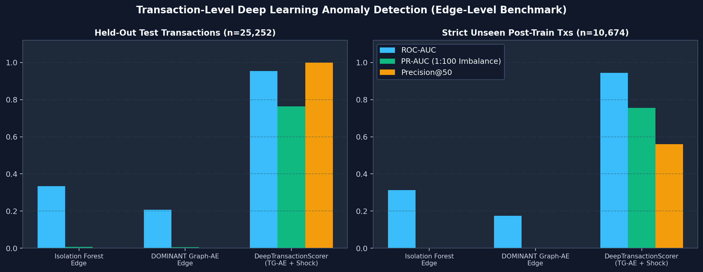
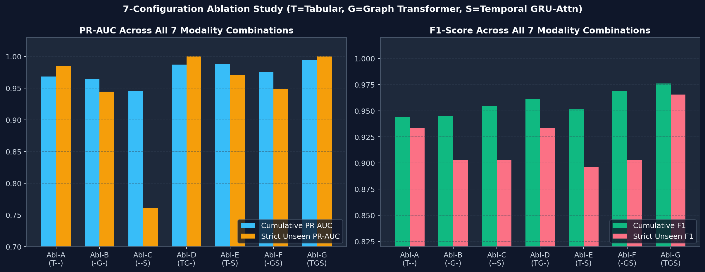

# ETHEREUM_GUARD_Project

**Mô hình phát hiện bất thường trong giao dịch Ethereum bằng học sâu (*Deep Learning Transaction & Account Anomaly Detection over Ethereum Graphs*)**

**Ethereum Guard** là hệ thống học sâu hai cấp độ (**Dual-Granularity Deep Learning**) phát hiện bất thường trên mạng lưới giao dịch Ethereum ở cả **cấp độ từng giao dịch (`tx_hash` — 66 ký tự)** lẫn **cấp độ tài khoản (`address` — 42 ký tự)**, tích hợp giải thích **XAI**, trực quan hóa đồ thị **1-Hop Ego-Network**, **FastAPI REST Service**, **Streamlit Web Dashboard**, và kết nối trực tiếp dữ liệu thời gian thực qua **Etherscan API V2**.

---

## 1. Kiến trúc Học sâu Cốt lõi

1. **Cấp độ Từng Giao dịch (`DeepTransactionScorer` — `src/models/tx_scorer.py`):**
   - Hợp nhất biểu diễn ẩn $z_u, z_v \in \mathbb{R}^{64}$ của ví gửi và ví nhận trích xuất từ **Modular TG-AE**, tương tác cạnh ($|z_u - z_v|$, $z_u \odot z_v$), 5 thuộc tính cạnh (`edge_attr`) và 6 tín hiệu **Behavioral Shock** (độ đột biến giá trị giao dịch so với mức trung bình lịch sử của ví gửi, giao dịch gọi hợp đồng thông minh `0 ETH`, nhận diện chữ ký hàm EVM 4-byte như `approve`, `transferFrom`, `setApprovalForAll`, `permit`).
   - Phân rã rủi ro giao dịch thành 3 thành phần giải thích được: `Sender Profile %` · `Receiver Profile %` · `Tx Shock & Value Dynamics %`.
2. **Cấp độ Tài khoản (`Modular TG-AE` — `src/models/encoders.py`, `src/models/tgae.py`):**
   - **TabularMLP:** Mã hóa 12 đặc trưng dòng tiền tĩnh.
   - **EdgeTransformerEncoder (`TransformerConv`):** Mạng Graph Transformer 2 lớp đa đầu chú ý (4 heads) tích hợp trực tiếp thuộc tính cạnh 5 chiều trên đồ thị con lân cận.
   - **TemporalAttentionGRU:** Mạng GRU 2 lớp kết hợp cơ chế chú ý thời gian Bahdanau trên chuỗi `10 × 8` cửa sổ 24 giờ.
   - Hợp nhất qua cổng học được (**Masked Gated Fusion**), tối ưu hóa bằng **Contrastive Margin + Focal Loss** và chuẩn hóa bất thường **IQR Calibration**.





---

## 2. Kết quả Thực nghiệm Đã Kiểm chứng

### 2.1. Cấp độ Giao dịch (`25.252` giao dịch Test & `10.674` giao dịch mới hoàn toàn sau mốc Train)
| Mô hình | Cumulative ROC-AUC | Cumulative PR-AUC | Cumulative F1 | Precision | Strict Unseen F1 | Strict Unseen Precision |
| :--- | :---: | :---: | :---: | :---: | :---: | :---: |
| `Tx-BL1: Isolation Forest Edge` | `0.3348` | `0.0068` | `0.0198` | `1.00%` | `0.0071` | `0.36%` |
| `Tx-DL1: DOMINANT Graph-AE Edge` | `0.2075` | `0.0060` | `0.0198` | `1.00%` | `0.0071` | `0.36%` |
| **`Proposed: DeepTransactionScorer`** | **`0.9548`** | **`0.7630`** | **`0.8205`** | **`99.44%`** | **`0.8485`** | **`100.00%`** |

### 2.2. Cấp độ Tài khoản (`211` ví có nhãn trên đồ thị `1,79M` nút & `23` ví Strict Unseen)
| Mô hình | Cumulative PR-AUC | Cumulative F1 | FPR@90%TPR | Strict Unseen PR-AUC | Strict Unseen F1 |
| :--- | :---: | :---: | :---: | :---: | :---: |
| `BL-1: Isolation Forest` | `0.6246` | `0.8224` | `56.98%` | `0.5309` | `0.7568` |
| `DL-BL1: DOMINANT (GCN-AE)` | `0.4049` | `0.7440` | `100.0%` | `0.4597` | `0.7568` |
| `DL-BL2: GAT (Graph Attention)` | `0.9767` | `0.9502` | `8.14%` | `0.9538` | `0.7857` |
| `BL-2: XGBoost` | `0.9939` | `0.9766` | `2.33%` | `0.9821` | `0.9032` |
| **`Proposed: Modular TG-AE`** | **`0.9960`** | **`0.9762`** | **`1.16%`** | **`1.0000`** | **`0.9655`** |

---

## 3. Hướng dẫn Lấy API Key & Cấu hình File `.env`

> **Lưu ý:** Hệ thống vẫn chạy đầy đủ trên bộ dữ liệu mẫu có sẵn khi chưa cấu hình API key. Tuy nhiên, để **quét trực tiếp các địa chỉ ví mới và mã giao dịch `tx_hash` thời gian thực trên mạng chính Ethereum**, bạn cần đăng ký miễn phí **`ETHERSCAN_API_KEY`**.

### Bước 3.1. Lấy `ETHERSCAN_API_KEY` (Miễn phí — Khuyến nghị bắt buộc cho Live On-Chain)
1. Truy cập https://etherscan.io/register để tạo tài khoản Etherscan miễn phí và xác nhận email kích hoạt.
2. Đăng nhập và mở trang quản lý khóa API tại: https://etherscan.io/myapikey
3. Nhấn nút **`+ Add`** (góc trên bên phải) → Nhập tên ứng dụng vào ô `App Name` (ví dụ: `EthereumGuard`) → Nhấn **`Create New API Key`**.
4. Sao chép chuỗi khóa 34 ký tự vừa được cấp (ví dụ: `CXGEIFZ1...`).
   - *Hạn mức gói Free:* Tối đa **5 requests/giây** và **100.000 lượt gọi/ngày** (hệ thống đã tích hợp sẵn bộ điều tiết tốc độ `TokenBucketRateLimiter` 4.5 req/s nên không bị lỗi quá tải).

### Bước 3.2. Lấy `ALCHEMY_RPC_URL` (Tùy chọn — Không bắt buộc)
Biến này dùng khi mở rộng truy vấn trực tiếp node JSON-RPC Ethereum Mainnet (có thể **để trống** nếu chỉ dùng Etherscan V2):
1. Truy cập https://dashboard.alchemy.com/ (hoặc https://app.infura.io/) và đăng nhập bằng Google/GitHub.
2. Nhấn **`Create new app`** → Đặt tên bất kỳ → Chọn mạng **`Ethereum`** (`Mainnet`).
3. Bấm vào nút **`API Key` / `Networks`** và sao chép đường dẫn **HTTPS URL** (có dạng `https://eth-mainnet.g.alchemy.com/v2/YOUR_KEY`).

### Bước 3.3. Giải thích các Biến Cấu hình Nội bộ Còn lại

| Tên biến trong `.env` | Bắt buộc? | Ý nghĩa & Giá trị nên điền |
| :--- | :---: | :--- |
| `ETHERSCAN_API_KEY` | Khuyến nghị | Dán mã Etherscan API V2 vừa lấy ở Bước 3.1 để quét ví & `tx_hash` live trên Ethereum Mainnet. |
| `ALCHEMY_RPC_URL` | Tùy chọn | Dán HTTPS RPC URL của Alchemy/Infura (hoặc **để trống**). |
| `ETHEREUM_GUARD_API_KEY` | Tùy chọn | Mật khẩu do **chính bạn tự đặt** để bảo vệ endpoint `POST /predict/batch` qua header `X-API-Key`. **Để trống** khi chạy demo cục bộ. |
| `ETHEREUM_GUARD_API_URL` | Tùy chọn | **Để trống** khi chạy Streamlit trực tiếp (nhanh nhất). Điền `http://127.0.0.1:8000` nếu muốn Streamlit gọi thông qua server FastAPI. |
| `ETHEREUM_GUARD_CORS_ORIGINS` | Tùy chọn | Danh sách domain được phép gọi API, giữ mặc định `*` khi phát triển cục bộ. |

### Bước 3.4. Tạo File `.env` từ `.env.example`
Tại thư mục gốc dự án, tạo bản sao `.env` *(file `.env` đã được `.gitignore` chặn tự động để không bao giờ lộ khóa cá nhân lên GitHub)*:

```powershell
Copy-Item .env.example .env
```

Mở file `.env` và điền cấu hình theo mẫu:

```env
ETHERSCAN_API_KEY=DÁN_MÃ_ETHERSCAN_34_KÝ_TỰ_CỦA_BẠN
ALCHEMY_RPC_URL=
ETHEREUM_GUARD_API_KEY=
ETHEREUM_GUARD_API_URL=
ETHEREUM_GUARD_CORS_ORIGINS=*
```

---

## 4. Hướng dẫn Cài đặt & Khởi chạy Hệ thống

### 4.1. Cài đặt môi trường Python (3.10+)

```powershell
python -m venv .venv
.venv\Scripts\Activate.ps1
pip install -r requirements.txt
```

### 4.2. Nạp biến môi trường từ `.env`
- **Trên Windows PowerShell:**
  ```powershell
  Get-Content .env | Where-Object { $_ -match '^\s*[^#].+=' } | ForEach-Object {
      $k, $v = $_ -split '=', 2
      [System.Environment]::SetEnvironmentVariable($k.Trim(), $v.Trim(), "Process")
  }
  $env:PYTHONPATH = "."
  ```
- **Trên Linux / macOS (Bash/Zsh):**
  ```bash
  set -a && source .env && set +a
  export PYTHONPATH=.
  ```

### 4.3. Khởi chạy Giao diện Web Dashboard (Streamlit)

```powershell
python -m streamlit run src/app/dashboard.py
```
- Mở trình duyệt tại: **http://localhost:8501**
- Hỗ trợ nhập trực tiếp cả **mã giao dịch `tx_hash` (`0x...` 66 ký tự)** lẫn **địa chỉ ví (`0x...` 42 ký tự)**.

### 4.4. Khởi chạy Backend REST API (FastAPI + Swagger UI)

```powershell
python -m uvicorn src.app.service:app --host 127.0.0.1 --port 8000 --reload
```
- Tài liệu tương tác **Swagger UI**: **http://127.0.0.1:8000/docs**
- Các endpoint chính:
  - `GET /health` — Kiểm tra trạng thái nạp `ModularTGAE` và `DeepTransactionScorer`.
  - `GET /predict/tx/{tx_hash}` — Chấm điểm bất thường Học sâu cho 1 giao dịch (`66` ký tự).
  - `GET /predict/{address}?model=tgae` — Chấm điểm bất thường cho 1 ví (`tgae` hoặc `isolation_forest`).
  - `GET /transactions/{address}?max_txs=20` — Xếp hạng các giao dịch bất thường nhất của 1 ví.
  - `POST /predict/batch` — Quét hàng loạt tối đa 50 địa chỉ ví.
  - `GET /graph/{address}?max_edges=60` — Trích xuất đồ thị giao dịch 1-hop.
  - `GET /api/v1/stats` — Trả về toàn bộ bảng Benchmark, Ablation và phân tích lỗi.

### 4.5. Kiểm thử Tích hợp & Chạy Thực nghiệm

```powershell
# Chạy toàn bộ 19 bài kiểm thử tích hợp End-to-End (Extractor, Engine, TG-AE, TxScorer, API, UI)
python -m unittest -v tests/test_live_inference.py

# Kiểm thử nhanh pipeline trên tập sample 1.000 ví (< 10 giây)
python run_pipeline.py --mode sample

# Xuất lại toàn bộ 5 biểu đồ báo cáo (.png) vào docs/figures/
python scripts/generate_figures.py
```

---

## 5. Cấu trúc Thư mục Dự án

```text
ETHEREUM_GUARD_Project/
├── artifacts/
│   ├── checkpoints/          # Trọng số huấn luyện (best_tgae.pt, deep_tx_scorer.pt, dominant_gae.pt, gat_detector.pt, xgboost.pkl, isolation_forest.pkl)
│   ├── scalers/              # Bộ chuẩn hóa RobustScaler (tabular & graph)
│   └── results/              # Bảng số liệu thực nghiệm (.csv, .json)
├── configs/
│   └── default.yaml          # Cấu hình siêu tham số mô hình & pipeline
├── data/sample/              # Tập dữ liệu mẫu gọn nhẹ phục vụ chạy thử & test E2E ngay lập tức
├── docs/
│   ├── figures/              # 5 biểu đồ kết quả thực nghiệm độ phân giải cao (.png)
│   ├── final_report_draft.md # Báo cáo khoa học đầy đủ 9 chương
│   ├── literature_review.md  # Tổng quan 14 công trình nghiên cứu liên quan
│   └── UI_SERVICE_GUIDE.md   # Tài liệu vận hành API & giao diện
├── notebooks/                # Jupyter Notebooks EDA & phân tích kết quả Ablation
├── scripts/                  # Script xuất biểu đồ & kiểm toán dữ liệu
├── src/
│   ├── app/                  # Engine phục vụ suy luận, FastAPI service & Streamlit Dashboard
│   ├── evaluation/           # Khung đánh giá chuẩn hóa UnifiedEvaluator
│   ├── models/               # ModularTGAE, DeepTransactionScorer, DOMINANT, GAT, Baselines
│   ├── pipeline/             # Tiền xử lý, trích xuất đặc trưng đa phương thức & Etherscan V2 Adapter
│   └── schemas.py            # Hợp đồng dữ liệu 25 đặc trưng chuẩn
└── tests/
    └── test_live_inference.py # 19 kịch bản kiểm thử tự động End-to-End
```
